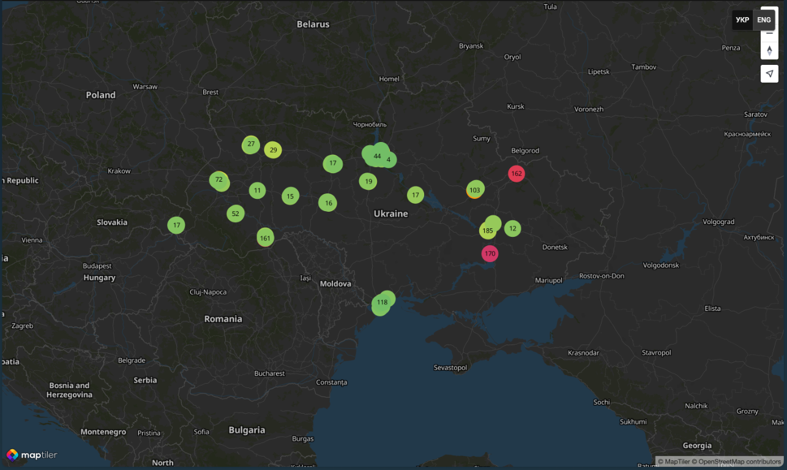
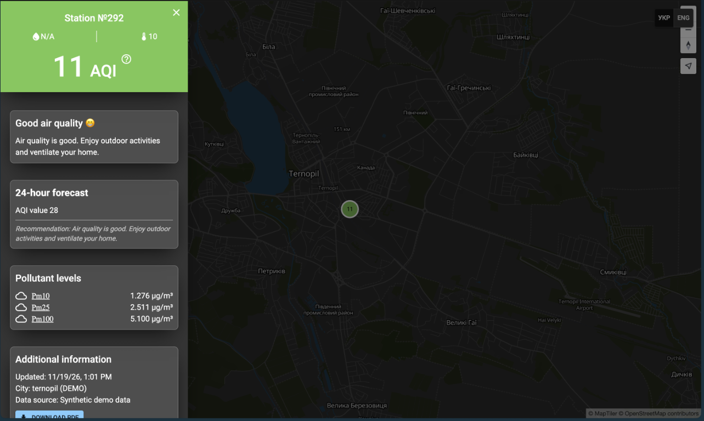
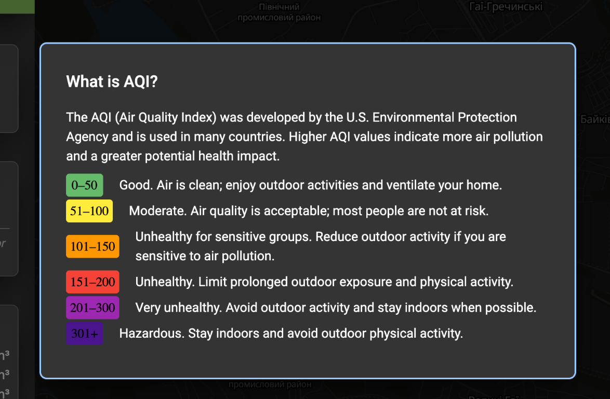

# Clear Air — Air Quality Map

A web application for viewing air quality index (AQI) readings on a map, exploring measurement history, and viewing a forecast based on recent data. The interface is available in Ukrainian and English.

## Features

- Interactive map with color-coded AQI readings by station.
- Current readings and measurement history for the last 48 hours and month.
- AQI forecast based on recent trends.
- Ukrainian and English language options.
- PDF air quality report export.
- Synthetic demo data clearly marked as `(DEMO)`.

## Screenshots

### Map overview



### Station details and forecast



### AQI guide



## Technology Stack

- **Next.js 16**, **React 19**, **TypeScript**
- **Material UI** and **MUI X Charts**
- **MapTiler SDK** for the interactive map
- **MySQL 8** and **mysql2**
- **Docker Compose** for running the app and database
- **jsPDF** and **jspdf-autotable** for PDF reports

## Installation and Docker Setup

You need Git and Docker Desktop (or Docker Engine with the Compose plugin).

1. Clone the repository and enter its directory:

   ```bash
   git clone https://github.com/Avalanche322/clear-air-app.git
   cd clear-air-app
   ```

2. Create a `.env` file in the project root:

   ```env
   DB_HOST=localhost
   DB_PORT=3306
   DB_USER=clear_air
   DB_PASSWORD=replace-with-a-secure-password
   DB_NAME=air_quality
   MYSQL_ROOT_PASSWORD=replace-with-another-secure-password
   NEXT_PUBLIC_MAPTILER_KEY=your_maptiler_api_key
   ```

   `NEXT_PUBLIC_MAPTILER_KEY` is required for the application to work. Get a key from [MapTiler Cloud](https://cloud.maptiler.com/account/keys/) and set it in `.env`. Rebuild the Docker app after adding or changing the key. Do not commit `.env` files containing real passwords or API keys.

3. Build and start the application:

   ```bash
   docker compose up --build -d
   ```

4. Open [http://localhost:3000](http://localhost:3000).

Check container status and view logs with:

```bash
docker compose ps
docker compose logs -f frontend db
```

Stop the containers without deleting the database data:

```bash
docker compose down
```

## Local Development

Node.js 22 or later is required. After creating the `.env` file as described above, start MySQL in Docker, install dependencies, and run Next.js:

```bash
docker compose up -d db
npm ci
npm run dev
```

Open [http://localhost:3000](http://localhost:3000). Other project commands:

```bash
npm run lint
npm run build
npm run start
```

## Database and Demo Data

When a new, empty MySQL volume is initialized, Docker runs the ordered SQL scripts in `migrations/` to create the schema and seed demo data. The old SQL dump in `dumps/` is not imported.

MySQL runs the scripts in `/docker-entrypoint-initdb.d/` only when the data volume is empty. To apply migrations to an existing database, run:

```bash
docker compose exec -T db sh -c '
set -e
for file in /docker-entrypoint-initdb.d/*.sql; do
  MYSQL_PWD="$MYSQL_PASSWORD" mysql -u"$MYSQL_USER" "$MYSQL_DATABASE" < "$file"
done
'
```

Migration `003_refresh_stale_dataset.sql` adds synthetic recent readings for stale stations and marks them as `(DEMO)`. Existing historical records are preserved.
